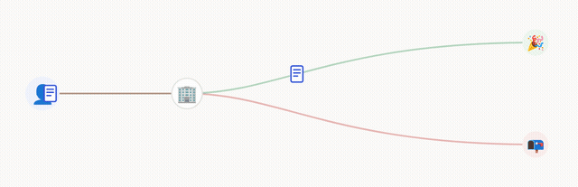
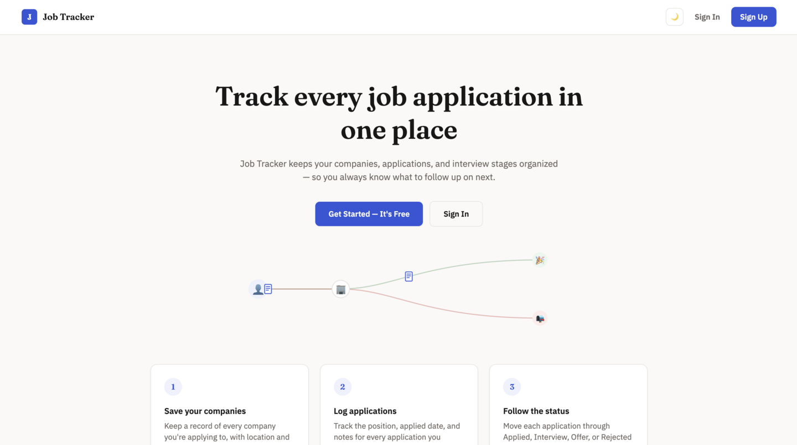
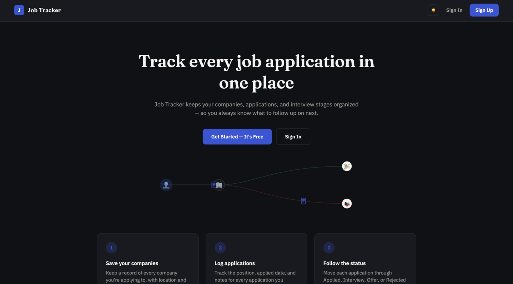
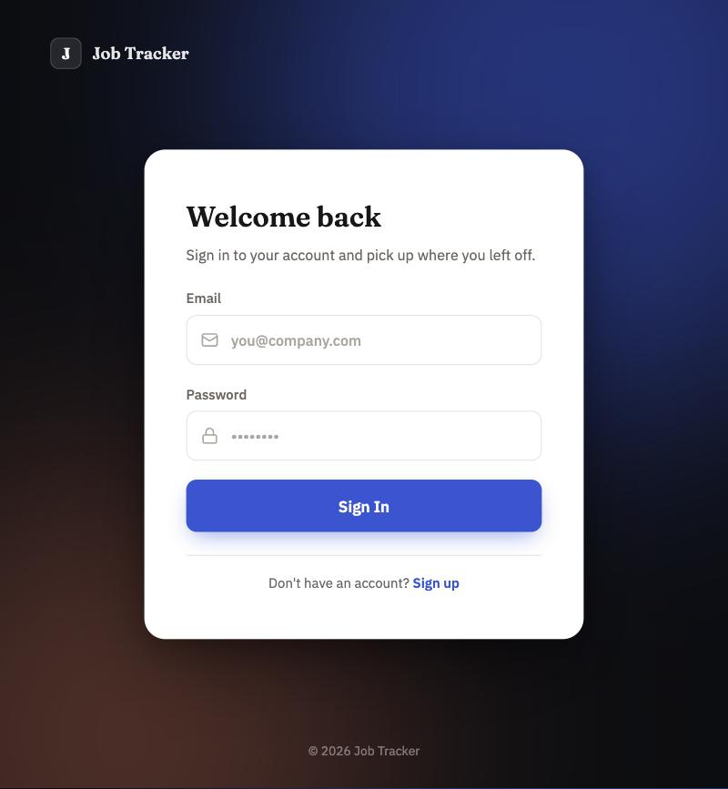
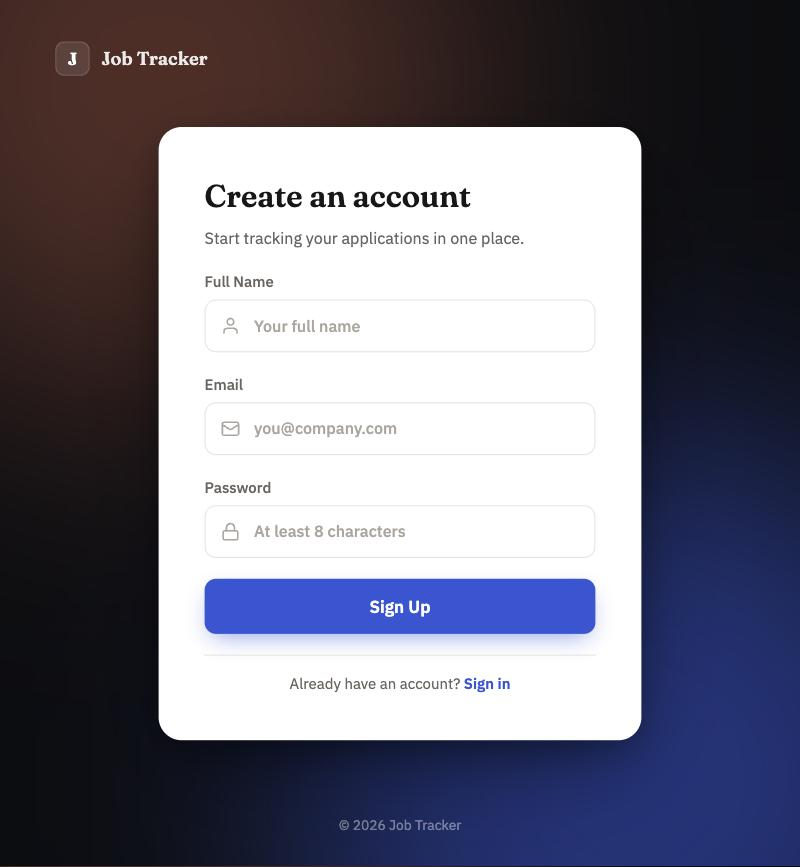

# Job Tracker


A full-stack job application tracker: register, save the companies you're applying to, log each application, and move it through a status pipeline (**Applied → Interview → Offer / Rejected**) with a full audit trail of every status change.

This is the **Java + Spring Boot** implementation of the project. It's the first of two planned backends for the same app — a companion **Python + FastAPI** version is planned next, built against the same React frontend and the same feature set, as a hands-on comparison between the two stacks.

<p align="center">
  
</p>

## Live demo

- **App**: [job-tracking-java-zeta.vercel.app](https://job-tracking-java-zeta.vercel.app/)
- **API** (Swagger UI): [job-tracking-java.onrender.com/swagger-ui/index.html](https://job-tracking-java.onrender.com/swagger-ui/index.html)

Both run on free tiers — see [Known limitations](#known-limitations) for what that means in practice (a short wake-up delay after idle periods).

## Table of contents

- [Live demo](#live-demo)
- [Screenshots](#screenshots)
- [Tech stack](#tech-stack)
- [Architecture](#architecture)
- [Data model](#data-model)
- [API endpoints](#api-endpoints)
- [Getting started](#getting-started)
- [Deployment](#deployment)
- [Testing](#testing)
- [Testing the API with Postman](#testing-the-api-with-postman)
- [Design notes](#design-notes)
- [Known limitations](#known-limitations)
- [Roadmap](#roadmap)

## Screenshots

| Landing page (light) | Landing page (dark) |
|---|---|
|  |  |

| Sign in | Create an account |
|---|---|
|  |  |

Every authenticated screen (dashboard, companies, applications, application detail with status history) shares the same dark-mode-aware design system shown above.

## Tech stack

**Backend**

- Java 21, Spring Boot 4.1.1
- Spring Data JPA (Hibernate) + PostgreSQL
- Spring Security with a stateless JWT filter chain (`jjwt` 0.13.0)
- Bean Validation (`spring-boot-starter-validation`)
- springdoc-openapi (Swagger UI)
- Lombok
- Maven (wrapper included — no local Maven install needed)
- JUnit / Spring Boot Test for controller and service tests

**Frontend**

- React 19 + TypeScript
- Vite 6
- Tailwind CSS v4 (`@theme` design tokens, class-based dark mode)
- React Router v7
- Axios (with a request interceptor that attaches the JWT)
- pnpm

## Architecture

The backend follows a standard layered structure:

```
Controller  →  Service  →  Repository  →  Database
   ↑              ↓
  DTOs        Entities
```

- **Controllers** (`AuthController`, `CompanyController`, `ApplicationController`) only handle HTTP concerns — request mapping, validation, pulling the authenticated user off the `Authentication` principal — and delegate everything else to the service layer.
- **Services** own the business rules: ownership checks (a user can only see/edit their own companies and applications), status-change auditing, and translating entities into response DTOs.
- **Repositories** are Spring Data JPA interfaces, several of them extended with `JpaSpecificationExecutor` so the search endpoints (`/api/companies/search`, `/api/applications/search`) can filter dynamically (`CompanySpecification`, `ApplicationSpecification`) instead of hand-writing a query per filter combination.
- **DTOs** keep entities off the wire in both directions — request DTOs carry `@NotBlank`/`@NotNull`/`@Email`/`@Size` validation, response DTOs shape exactly what the frontend consumes.

**Authentication flow.** Passwords are hashed with BCrypt. On login/register, the server issues a JWT whose subject is the user's email and which expires after `jwt.expiration-ms` (configurable). `JwtAuthenticationFilter` runs once per request, validates the `Authorization: Bearer <token>` header, and — if valid — populates the Spring Security context so `Authentication.getName()` returns the caller's email everywhere downstream. `/api/auth/**` and the Swagger routes are the only endpoints that don't require a token (`SecurityConfig`); everything else does.

**Frontend state.** Two small React contexts carry cross-cutting state: `AuthContext` (JWT + email + full name, persisted to `localStorage`, with a lazy fetch of `/api/auth/me` the first time a page needs the display name) and `ThemeContext` (light/dark, toggled by adding/removing a `dark` class on `<html>`, persisted to `localStorage`, defaulting to the OS preference on first visit). A `ProtectedRoute` wrapper in `App.tsx` redirects to `/login` whenever a protected route is hit without a token.

## Data model

```
User ──< Company ──< Application ──< StatusHistory
```

- A **User** owns many **Companies**.
- A **Company** has many **Applications** (deleting a company with existing applications is blocked server-side).
- An **Application** belongs to exactly one company and carries a `status` (`APPLIED`, `INTERVIEW`, `OFFER`, `REJECTED`).
- Every status change — including the initial `APPLIED` on creation — writes a **StatusHistory** row (status, timestamp, optional note), so an application's full timeline can be reconstructed and displayed.

## API endpoints

All routes below are prefixed with `/api` and, except for `/api/auth/*`, require `Authorization: Bearer <token>`.

| Method | Path | Description |
|---|---|---|
| POST | `/auth/register` | Create an account, returns a JWT |
| POST | `/auth/login` | Authenticate, returns a JWT |
| GET | `/auth/me` | Current user's id, full name, email |
| GET | `/companies` | List the caller's companies |
| POST | `/companies` | Create a company |
| GET | `/companies/{id}` | Get one company (must be owned by the caller) |
| PUT | `/companies/{id}` | Update a company |
| DELETE | `/companies/{id}` | Delete a company (fails if it still has applications) |
| GET | `/companies/search` | Paginated search by name/location |
| GET | `/applications` | List the caller's applications |
| POST | `/applications` | Create an application (starts as `APPLIED`) |
| GET | `/applications/{id}` | Get one application |
| PUT | `/applications/{id}` | Update an application |
| PATCH | `/applications/{id}/status` | Change status (writes a StatusHistory entry) |
| GET | `/applications/{id}/status-history` | Full status timeline for an application |
| DELETE | `/applications/{id}` | Delete an application |
| GET | `/applications/search` | Paginated search by status/company |

Once the backend is running, the same contract is browsable at `http://localhost:8080/swagger-ui.html` (springdoc + a bearer-auth security scheme are already wired up in `OpenApiConfig`) — the fastest way to try an endpoint without leaving the browser.

## Getting started

### Prerequisites

- Java 21 (backend)
- Node.js 20+ and pnpm (frontend)
- PostgreSQL running locally (or reachable) with an empty database created for this project

### 1. Backend

`backend/src/main/resources/application.properties` is intentionally **not** committed (it holds your local DB credentials and JWT secret). Create it with:

```properties
spring.datasource.url=jdbc:postgresql://localhost:5432/job_tracking
spring.datasource.username=<your-postgres-user>
spring.datasource.password=<your-postgres-password>

spring.jpa.hibernate.ddl-auto=update
spring.jpa.show-sql=true

jwt.secret=<a-long-random-string-at-least-32-bytes>
jwt.expiration-ms=86400000

server.port=8080
```

Then run:

```bash
cd backend
./mvnw spring-boot:run
```

The API starts on `http://localhost:8080`. With `ddl-auto=update`, Hibernate creates/updates the schema (`app_user`, `company`, `application`, `status_history`) automatically on first run.

### 2. Frontend

```bash
cd frontend
pnpm install
pnpm dev
```

The app starts on `http://localhost:5173` and is already configured (`src/api/client.ts`) to call the backend at `http://localhost:8080`. CORS is pre-configured on the backend (`SecurityConfig`) to allow exactly that origin.

Open `http://localhost:5173`, sign up, and start tracking applications.

## Deployment

The [live demo](#live-demo) above runs across three free-tier services. This is how it's wired together:

**Database — Supabase.** A Supabase project provides the Postgres instance. Its pooled connection string (Session pooler, `aws-0-<region>.pooler.supabase.com:5432`) is split into the three JDBC variables below.

**Backend — Render.** Deployed as a Docker-based Web Service from `backend/Dockerfile` (`eclipse-temurin:21`), with `backend` as the service's root directory. Render assigns the listening port at runtime via `$PORT`, so the start command passes it through explicitly: `java -jar target/*.jar --server.port=$PORT`.

Environment variables (Spring maps `SCREAMING_SNAKE_CASE` env vars to the equivalent dotted `application.properties` key automatically):

| Variable | Value |
|---|---|
| `SPRING_DATASOURCE_URL` | `jdbc:postgresql://<supabase-pooler-host>:5432/postgres` |
| `SPRING_DATASOURCE_USERNAME` | Supabase pooler username, `postgres.<project-ref>` |
| `SPRING_DATASOURCE_PASSWORD` | the database password set when creating the Supabase project |
| `SPRING_JPA_HIBERNATE_DDL_AUTO` | `update` |
| `JWT_SECRET` | a long random string, generated once for this deployment |
| `JWT_EXPIRATION_MS` | `86400000` |
| `CORS_ALLOWED_ORIGINS` | comma-separated allowed origins, e.g. `http://localhost:5173,https://<your-frontend>.vercel.app` |

**Frontend — Vercel.** Deployed with `frontend` as the root directory; Vite is auto-detected, so build command and output directory need no changes. One environment variable:

| Variable | Value |
|---|---|
| `VITE_API_URL` | the Render backend's URL, e.g. `https://job-tracking-java.onrender.com` |

**How the two sides find each other.** Neither URL is hardcoded. The frontend reads `VITE_API_URL` at build time (`src/api/client.ts`); the backend reads `CORS_ALLOWED_ORIGINS` at runtime (`SecurityConfig.java`) and only accepts requests from the origins listed there. Moving either service to a new URL later is an environment variable update, not a code change.

## Testing

The backend has controller and service tests for all three feature areas:

```bash
cd backend
./mvnw test
```

Covers: `AuthControllerTest`, `AuthServiceTest`, `CompanyControllerTest`, `CompanyServiceTest`, `ApplicationControllerTest`, `ApplicationServiceTest`, plus a context-load smoke test (`JobTrackingApplicationTests`).

**CI:** every push and pull request runs the backend build + tests against a real PostgreSQL service container, and type-checks + builds the frontend (`.github/workflows/ci.yml`).

## Testing the API with Postman

1. `POST /api/auth/register` with a JSON body (`fullname`, `email`, `password`) → copy the `token` from the response.
2. In Postman, set that token as a collection/environment variable (e.g. `{{token}}`) and add an `Authorization: Bearer {{token}}` header (or the Bearer Token auth type) to every other request.
3. From there, `POST /api/companies` to create a company, then `POST /api/applications` with that company's id, then `PATCH /api/applications/{id}/status` to move it through the pipeline and watch `GET /applications/{id}/status-history` grow.
4. Swagger UI (`/swagger-ui.html`) exposes the same "Authorize" flow visually if you'd rather not hand-manage headers.

## Design notes

A few deliberate choices worth calling out:

- **Stateless auth, JWT in `localStorage`.** Simple for a project this size; a production app would want an httpOnly cookie and refresh-token rotation instead (see [Known limitations](#known-limitations)).
- **Ownership enforced in the service layer**, not just by hiding UI — every company/application lookup is scoped by the caller's id (`findByIdAndOwner`, `findByIdAndUser`), so one user can never read or modify another user's data even by guessing an id.
- **Dark mode is a CSS variable swap, not a second stylesheet.** Tailwind v4's `@theme` block defines the design tokens once; a `.dark` class on `<html>` overrides the same variable names, so every component that uses `bg-paper`/`text-ink`/etc. is dark-mode-aware for free.
- **The animated pipeline on the dashboard** (candidate → company → offer/rejection, shown above) is hand-built SVG + SMIL (`<animateMotion>`), not a GIF or a JS animation library — it's a few KB and fully CSS/SVG driven.
- **Consistent error responses.** A global `@RestControllerAdvice` maps errors to proper status codes with a JSON body (`status`, `error`, `message`, optional per-field `errors`): 400 validation, 401 bad credentials / missing or expired token, 404 not found (also used for other users' data, so ids can't be probed), 409 duplicate email or company still in use, 429 too many failed logins.
- **Brute-force protection.** After 5 failed logins for the same email within 15 minutes, further attempts are rejected with 429 until the window passes. The counter is in memory — fine for a single instance; multiple instances would need a shared store such as Redis.
- **English-only UI.** The app was originally built with mixed Turkish/English copy; it was fully translated to English so it reads consistently for any audience reviewing the project.

## Known limitations

Being upfront about what's intentionally out of scope for a learning/comparison project:

- `UserController` (`/api/users/me`) and `AuthController` (`/api/auth/me`) currently duplicate the same "current user" lookup — a leftover from iterating on the `/me` endpoint. Harmless, but should be collapsed into one.
- No refresh tokens — a JWT simply expires after `jwt.expiration-ms` and the user has to log in again.
- `spring.jpa.hibernate.ddl-auto=update` is used for the live demo's database too; a real deployment would use versioned migrations (Flyway/Liquibase) instead.
- The live demo runs on free tiers: Render's free Web Service spins down after ~15 minutes without traffic, so the first request after a while takes about a minute to wake it back up (not a failure — just the free-tier trade-off). Supabase pauses a free project after a week of total inactivity; a scheduled GitHub Action (`.github/workflows/keep-alive.yml`) calls `GET /api/health` — which runs a database query — every 3 days to prevent that. (GitHub disables scheduled workflows after 60 days without repository activity; re-enable it from the Actions tab if that happens.)
- The account lockout is keyed by email, so someone who knows a user's email could deliberately lock that account for 15 minutes. A production setup would combine it with per-IP limits and CAPTCHA.

## Roadmap

This repository is the **Java/Spring Boot** half of a two-part comparison. Once it's fully polished, the same product (same data model, same React frontend, same feature set) will be rebuilt with a **Python/FastAPI** backend, to make an informed, hands-on decision between the two stacks for future backend work.